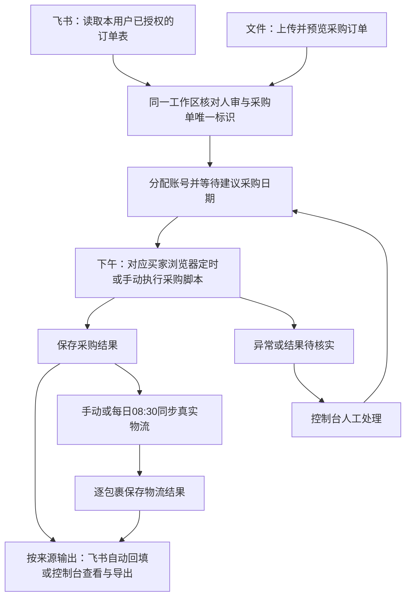

# 采购与订单同步系统落地方案 v1

初稿：2026-10-23；修订：2026-11-05。状态：方案草案。订单支持飞书接入和表格文件导入；首期只有所有者本人，后续面向各自使用飞书的个人用户。尚未开发、部署或启用任何业务写入。

本方案依据流程讨论、既有的小蜜蜂客户端逆向报告、10月23日对现有系统的只读核对，以及11月5日核对的飞书官方资料。“已确认”来自用户决策；“建议”是设计选择。供应商接口、浏览器自动启动和各用户实际表格的字段及权限仍需核验。

## 界面模板（前端和浏览器插件共用）

采购控制台前端与自有浏览器插件均使用[指定的 Claude Artifact 界面模板](https://claude.ai/artifact/79rovitE1iBjEJ1xwhN8qP)。控制台将模板用于订单列表、配置及详情；插件将同一套视觉与交互样式适配到浏览器内的小面板。功能、权限和状态以本文为准；采购脚本仍由对应买家浏览器定时或手动执行。

## 1. 首期交付目标

每个控制台用户可选用飞书多维表格自动接单，也可直接上传订单文件，或在同一工作区交替使用两种方式。飞书不是开户、采购或查看物流的前提。两种来源沿用同一套人审准入、分配、采购日期及执行规则；按原订单归属回填飞书或在控制台查看、导出结果。下午仍由对应买家浏览器定时或手动启动采购脚本。

首期包含：自动接收审核通过的采购订单、账号自动分配及人工调整、对应买家浏览器内手动或定时执行插件采购、采购异常处理、采购结果自动回填、手动及定时物流同步、取消处理和人工决定重新采购。

采购执行只有一个步骤：对应买家浏览器定时或手动启动脚本。控制台准备和分配任务，无需在控制台另点一次“开始采购”。采购模式及时间可在控制台配置并同步至插件，实际执行发生在对应浏览器中。流程熟悉后，再开放检测到已到采购日期的待采购订单就自动执行的模式。

沿用上游已经拆分好的采购订单：一笔采购订单进行一次独立采购，不重新设计沃尔玛多商品订单的拆分或合并。亚马逊将一次采购拆成多个包裹时，完整跟踪包裹，不新增采购任务。

## 2. 系统分工与接入位置

|组成|负责什么|首期落地方式|
|---|---|---|
|现有 WalmartAPI-Contral|沃尔玛拉单、商品采集与脚本审核、销售及取消信息|沿用现有业务链；每小时拉单是用户描述的当前安排，本轮未核验线上调度|
|飞书多维表格（可选）|接入本用户已授权的订单来源和结果表|按连接读取人审结果和采购输入，自动回填预先绑定的结果列|
|表格文件（可选）|上传来自其他流程的已拆分采购订单|建议首期支持 Excel（.xlsx）和 CSV；导入时预览、核对审核状态及重复项，结果可按批次导出|
|采购服务与控制台|接收采购任务、账号分配、采购模式与时间配置、任务状态管理、异常处理、结果保存、物流同步调度、回填重试|建议作为独立模块交付，通过明确的读写接口接入现有系统；采购无需控制台二次启动|
|买家浏览器插件|在对应买家已登录环境中定时或手动启动采购脚本、核实结果、采集真实订单与包裹信息|独立实现自有插件；借鉴参考系统流程，不依赖其后台接口|
|物流对接模块|保存真实包裹轨迹、处理经过核实的第三方服务关联、记录下游提交结果|亚马逊轨迹采集纳入首期；邮政、佳成及沃尔玛发货联动单独接入验收|

已确认的运行环境：买家账号主要在当前这台 Mac 的 Chrome／紫鸟中使用，偶尔会换到其他电脑；控制台可能部署云端，尚未选定最终部署位置。

据此，控制台和浏览器执行端分别设计：控制台保存任务、账号配置、额度和结果，浏览器插件主动连接服务端领取任务并回传。服务端允许部署云端，采购及买家订单读取仍在对应电脑已登录的浏览器中完成。首期不把远程控制整台电脑或搬迁亚马逊登录会话作为前提。

图中的异常返回待采购，仅适用于已排除重复下单风险且符合恢复条件的任务。“已经成功、只是回填失败”只重试回填。

10月23日的代码核对发现：

- 现有系统使用 `order_line_id` 关联订单中心数据。采购任务应保存上游采购订单的原始唯一标识及其订单行关联，避免用当前商品编码或买家名称重新拼接身份。
- `services/order_center.py` 已有业务完成后更新飞书及变化行推送的机制，但“主订单表／采购信息”目前只补齐键，不能误认为已有完整的采购结果自动回填。
- `docs/feishu_tables.md` 将人工列、公式列、关联列与程序列分开。接入时需为采购结果列明确写入归属，避免旧同步程序与新服务相互覆盖。
- 现有脚本的“采购方”匹配与本次“买家账号”分配不是同一概念。其价格口径也不同，不能直接复用旧采购方匹配规则代替本次账号规则。
- WalmartAPI-Contral＋飞书是所有者现有业务的第一套字段样本，不是其他用户必须采用的上游。另一“沃尔玛操作台”项目仍可作为未来整合目标。

## 3. 已确认的采购规则

### 3.1 任务准入与采购日期

人工审核通过即通过，脚本审核保留为参考，不增加小蜜蜂式二次审批。飞书读取明确的人审通过结果；文件中已有明确人审通过结果的行按同样条件准入。单纯上传文件不等于已审核，缺失人审依据的行留在待确认区，不下发采购。

建议采购日期计算：**原订单下单日期＋6天－采集到的配送天数**。“今日”已明确指原订单下单日期，不是当前日期或审核日期。例如下单日期为10月23日、配送天数为4天，建议采购日期为10月25日。

只有建议采购日期不晚于执行当天的任务才能开始采购。未到日期的任务可以展示分配结果，但不可提前执行；未来任务不消耗今天已成功采购的额度。到期执行时再次校验账号容量和任务状态。

无论定时还是手动启动，对应浏览器脚本只领取分配给该买家账号、已经到采购日期且满足执行条件的任务；领取、校验和采购属于同一次脚本执行，不增加人工启动步骤。

建议：缺少可信下单日期、配送天数或建议日期时进入“资料待补齐”，不把缺失值当作0。配送估计发生变化时保留计算依据和旧值；建议采购日期是否随之自动重算，应在接入现有公式时确认。

### 3.2 账号配置与分配

|配置或规则|确定行为|
|---|---|
|账号金额区间|按商品单价×数量的合计匹配，不含税费和运费|
|每日最大采购单数|逐账号配置；约20单是现有经验，不写死为所有账号上限|
|每日计数|北京时间零点切换新一天；一次成功采购计1单，与商品数量无关|
|优先级|0—9，9最高，默认2|
|相同优先级|按账号名称顺序分配|
|分配顺序|先在订单数量、金额匹配和可用额度允许的范围内，尽量让每个启用账号分到至少1单；然后优先填满高优先级账号的剩余额度|
|人工调整|自动分配后允许改账号；调整仍需满足金额区间及可用额度|
|采购开关|关闭后停止接收新分配，已分配任务继续；它不是停止执行按钮|
|同步开关|独立控制该账号的订单及物流同步|

“至少1单”不能突破商品区间、额度或订单数量。需要先照顾可选订单少的账号：A接受20—30美元，B接受20—50美元，有25美元和45美元两单时，应给A分25美元、B分45美元。无法覆盖的账号显示原因。

建议把“至少1单”按北京时间当天的已分配／已完成情况统计，避免每个新批次都重新均分。该统计周期是推荐默认值，尚未单独确认。

执行中的任务预占名额；明确未创建订单才释放；结果不明持续占用并等待核实。跨零点必须保留未完成任务及预占记录，不能因日计数重置而解除防重复保护。跨日预占对新日可用额度的扣减，以及成功后取消是否返还额度，需在开发前定稿。

### 3.3 采购前校验

|校验|规则|
|---|---|
|账号金额区间|商品小计符合所选账号区间；商品小计48美元、结算总额52美元，仍可匹配20—50美元的账号|
|订单限价|**含税费和运费的最终应付总额≤当前有效限价**；上述结算总额52美元、限价50美元时必须拦截|
|配送时长|结算时实际配送估计不超过该账号的有效最长配送天数|
|全局配送默认值|初始10天，可在服务端修改|
|账号配送设置|允许单独设置，可从服务端或插件修改同一个账号配置|
|商品与地址|核对当前采购商品、数量和收件信息，避免沿用其他任务的结算内容|

建议：未单独设置的账号继承全局默认值，单独设置的账号保留覆盖值，提供“恢复默认”。插件显示服务端已确认的有效设置；未同步成功的修改不得显示为已生效。最终提交前重新校验有效限价和配送配置。

建议：商品、税运费、限价必须有一致的币种和金额单位；接入时核对飞书字段，不能仅凭列名复用现有脚本金额。无法读到可靠结算总额或配送日期时进入异常，不默认放行。

## 4. 控制台操作与异常处理

建议在原有五个业务页面之外，增加“订单来源”入口：

|页面|主要内容和操作|
|---|---|
|订单来源|在自己的工作区连接飞书或上传文件；设置字段对应、预览、查看同步／导入记录及结果导出|
|待采购|今日可采购、未来日期、待分配；查看分配原因、改账号、查看对应浏览器执行状态|
|采购记录|采购中、成功、结果待核实、已取消；查看每次采购尝试和亚马逊订单关联|
|异常处理|超限价、缺货、超配送时间、账号暂停、等待验证、取消后待决定重采|
|账号管理|金额区间、每日额度、优先级、配送天数、采购／同步开关、采购执行模式与时间、绑定电脑和浏览器环境、当前执行位置、在线及登录状态|
|订单与物流同步|未发货、运输中、延迟、已签收；手动同步、定时设置、最近成功时间、回填失败|

账号的“暂停执行”应与“关闭接新单”分别呈现，避免用户以为关闭采购开关会终止旧任务。

|异常或事件|已确认处理方式|
|---|---|
|超限价、缺货、超最长配送时间|暂停当前任务，记录原因，其他任务继续|
|提交前页面加载错误|自动重试一次，仍失败则转异常|
|登录失效、账号受限、明确银行卡拒付|暂停该账号的采购执行，其他账号继续|
|银行人工验证|等待人工处理，保留任务和名额|
|已点击提交但无法确认结果|进入“结果待核实”，暂停该账号；核查亚马逊订单后再决定，不能直接重买|
|采购已成功，服务端或飞书回填失败|保留成功事实，只重试保存或回填，不再次执行采购|
|调整限价或商品|在采购控制台处理，不回填飞书；保存原值、实际执行值及修改记录|

采购成功、飞书回填成功、物流同步成功分开记录。一次网络请求成功不等于订单已采购或结果已正确落表。

建议执行保护：同一账号在本系统内一次只执行一笔采购；同一采购任务只能有一个有效执行者，限制覆盖所有电脑、浏览器环境和标签页，由服务端统一协调。刷新浏览器、重复点击、重启或任务超时均不能自动重新付款。已提交的任务即使执行者离线，也先进入查单核实，不能仅因超时便交给另一台电脑重新执行。插件与服务端均保存必要的结果回执，服务恢复后补交。

修改商品或限价后，任务恢复前重新校验当前商品与账号匹配。修改不改变上游采购订单身份，不产生另一笔重复任务。自动重试与人工重新采购在记录中分开。

## 5. 取消与人工重新采购

|情况|已确认处理|
|---|---|
|未开始采购，沃尔玛订单取消|移出待采购队列，解除账号分配|
|执行中收到取消，尚未提交|停止当前采购|
|执行中收到取消，已经提交|先核实是否下单成功，不能直接判定为未采购|
|采购成功后，沃尔玛取消或退款|提醒人工处理对应亚马逊订单，保留采购及退款记录|
|亚马逊取消采购订单|进入“待人工决定是否重新采购”，不自动重买|

人工决定重采时展示：原取消原因、最新商品和最终金额、最新预计送达日期、原销售订单的最晚送达日期（有可信数据时），以及原采购的退款情况。

人工同意重采后，重新校验限价、配送时长、库存、账号匹配与额度，再进入待采购队列，沿用当前执行模式。原亚马逊订单及费用、退款记录保留，新一次采购单独记录。

建议显示“预计晚于销售订单要求”的明确提示。是否额外设置禁止超销售订单最晚送达日期的硬性限制尚未决定，不把该提示擅自做成新的阻断规则。用户确认重采也不豁免已确认的限价和账号配送上限。

## 6. 两种订单来源与个人工作区

已确认：首期只有所有者本人；后续可能有多个独立飞书个人用户，每人一个控制台账户，其表格可以不同。建议每个用户有独立工作区：一个工作区能使用文件导入，也能绑定自己的飞书表。控制台用户、飞书授权身份、亚马逊买家账号是三种身份；不能用其中一个替代另外两个。

### 6.1 飞书怎么连接

**首期推荐**：先检查现有运营集成是否有适用于本人目标多维表格且允许在采购服务中使用的开放平台应用；合适时通过既有服务端接入，不复制旧生产系统的密钥。否则在本人有创建及发布权限的飞书组织内配置专用自建应用。若当前个人身份暂不具备接入条件，文件入口仍可独立使用。

1. 管理端一次性配置应用身份（App ID 和 App Secret 仅由服务端托管）。按需开通读取数据表、字段和订单记录的接口权限；需要自动回填时另开记录更新权限，并使权限在目标组织中生效。群聊 Webhook 只可用于通知，不参与订单授权或数据传输。[官方机器人区别](https://open.feishu.cn/document/feishu-cards/quick-start/send-message-cards-with-custom-bot)；[官方应用身份说明](https://open.feishu.cn/document/uAjLw4CM/ukTMukTMukTM/authentication-management/access-token/tenant_access_token)。
2. 由有权限的表格管理者，在**目标多维表格 → 右上角「…」→「更多」→「添加文档应用」**中添加应用。只读接单与读写回填分别配置。启用高级权限的表需额外检查目标数据表的角色与可见范围；“请求成功但读不到已知记录”不能算连接成功。[飞书多维表格官方 FAQ](https://open.feishu.cn/document/docs/bitable-v1/faq?lang=zh-CN)。
3. 在控制台“订单来源 → 连接飞书”中粘贴本人的多维表格链接，选择订单所在的数据表及结果写回的数据表（可以不同），分别映射采购单标识、人工审核、商品、数量、限价、建议日期及结果列。飞书链接用来定位表，不等于授予用户访问权。显示已获准绑定的表，服务端验证绑定者对目标表的权利；不能凭共享应用能读到某张表就让任意用户认领。
4. 连接向导用一条已知样本预览读到的订单，并展示拟写入的目标行及字段；只读预览不修改生产数据。写入权限在专用测试记录上完成接入验收前显示“回填待验证”。通过后，按这条连接定期读单；采购成功回填实际账号、亚马逊订单号和实付金额，物流变化回填已绑定的结果列。保存来源及结果行的稳定标识；改绑新表不把历史待回填自动改投新表。

**多人扩展**：同一飞书组织可用一套应用凭证，但各工作区的表绑定、字段映射和回填目的地仍独立。多个个人用户不预设属于同一组织，不分发首个用户的 App Secret。少量用户可先选文件，或在具备条件时由各自的组织提供独立应用连接。以后需要对外自助“连接我的飞书”时，再评估对目标个人用户可用的商店应用，以每位用户的飞书授权（OAuth）在其权限范围内操作，并处理授权续期／撤销。不能仅加一个飞书登录按钮，就让单组织自建应用跨组织通用。[飞书官方应用类型与适用人群](https://open.feishu.cn/document/home/app-types-introduction/robots-web-applications-and-mini-programs)；[飞书用户授权说明](https://open.feishu.cn/document/client-docs/build-login-free-system-)。

### 6.2 文件怎么导入

建议提供标准模板，也允许把不同表头对应到系统字段并保存为个人模板。上传 → 选择工作表及字段 → 预览新单、重复、缺字段及历史已采购 → 导入有效行，下载有问题的行及原因。保留批次、来源和原始采购单标识；不改写用户电脑上的原文件。

- 在同一工作区以同一业务范围下的**上游采购单唯一标识**去重，重复上传或先飞书后文件不会再买一次。文件名、行号、ASIN、飞书记录 ID 均不能单独作为跨来源的采购单号。无法可靠对齐或输入冲突时待核实，不新建可执行任务。
- 已有可信亚马逊订单号的行进入历史采购／物流同步；数据矛盾先核实。文件是导入时的快照，上游后续取消需要显式更新文件或在控制台登记；下一份文件缺少某一行不代表取消。
- 文件订单的采购和物流结果在控制台查看、按批次导出，不要求连接飞书，不自动写入某个“默认飞书表”。同一订单后续确需回填飞书，先明确绑定该工作区的目标记录并核对唯一标识。

### 6.3 多人隔离与结果归属

订单、文件、导出、飞书连接、表与字段映射、采购账号池、插件任务及回填重试均由服务端按工作区限制。甲的插件、粘贴的链接或导出请求不能访问乙的资源；同号订单出现在不同工作区也不能互相查询或回填。首期无需开发公共注册或商店应用，但不能把本人表格和账号写死成系统全局配置。下表中涉及飞书的行为只适用于已明确绑定该来源／目的地的订单。

|信息|来源／修改入口|同步方式|
|---|---|---|
|原采购订单唯一标识、销售关联、原商品及数量、收件信息|已绑定的飞书表或上传文件|读取并保留原始关联；不能用修改后的商品重新生成任务身份|
|人工审核结果|现有人工审核入口|读取明确的人审通过结果，不用脚本通过替代人工通过|
|建议采购日期|当前公式和已确认的业务口径|读取现有结果或按同一口径计算；公式列不直接写入|
|原始限价／商品|飞书或文件输入|用于首次接入和保留原始依据|
|控制台有效限价／商品覆盖值|采购控制台|只作用于采购；不回填飞书，后续导入不得覆盖|
|采购账号|控制台分配或人工调整|实际分配及采购结果按对应字段回填；已在执行的任务不能被外部修改悄悄换号|
|亚马逊订单号、实际付款金额|已核实的采购结果|先可靠保存；飞书来源按绑定回填，文件来源可查看、导出|
|真实包裹物流、预计送达、签收状态|订单／承运商实际信息|逐包裹保存，按明确的汇总规则回填|
|回填结果与错误|采购服务|记录目标行、字段、结果版本、最后成功时间和失败原因|

接入约束与建议：

1. 重复接收同一采购订单只更新允许变化的信息，不新建采购任务。采购订单与 `order_line_id` 的实际对应关系需核对，不能假定任意场景下永远一对一。
2. 先核对字段类型和关联关系，优先写已有可写字段的源表；不能尝试写飞书公式或关联展示列。旧程序仍只写自己负责的列。
3. 如果控制台已有商品／限价覆盖值，飞书再次变化只更新原始参考值并提示差异，实际执行值保持控制台设定。
4. 建议定期增量读取人工审核变化，并在对应浏览器脚本领取任务时刷新涉及订单的审核与取消信息；读取频次及是否有可用事件通知，在接入核验后确定。
5. 写回按订单、字段和结果版本去重；较旧的重试不能覆盖更新结果。只重试失败项，不重跑采购批次。
6. 多次采购的完整费用和退款历史保存在控制台；飞书现有单值列如何显示“当前有效采购”需做字段映射，不能覆盖唯一的历史凭据。
7. 飞书故障时明确显示“已采购／待回填”。对于无法取得可靠准入信息的未执行任务，建议等待来源恢复；不能因回填故障把已成功任务改成待采购。

## 7. 订单和物流同步

### 7.1 触发方式

已确认：控制台支持手动同步和定时同步，默认每天北京时间08:30一次，时间及频次可修改。采购开关与同步开关互相独立。

这是待开发系统中的调度配置，本方案未创建任何实际定时任务。

参考小蜜蜂的“服务端选订单、插件逐笔采集”结构。已知其服务端通过 `getNeedSyncOrders(customerId)` 返回任务，但后台完整筛选和停止逻辑未取得，不能声称完全复刻。

建议采用下列同步范围与停止规则：

|订单情况|行为|
|---|---|
|账号启用同步、已有亚马逊订单号、配送未完成|纳入同步，包含历史已采购订单|
|未发货、运输中、延迟、暂时无轨迹|继续同步|
|一次页面失败、暂时查不到订单|保留上次有效信息并记录本次错误，之后重试；不据此断定订单不存在|
|全部相关包裹实际签收|停止常规轮询，保留手动复查|
|确认取消且不存在仍在运输的包裹|停止该次采购的常规同步；关联的新采购独立继续|
|退款但仍有包裹运输|继续物流跟踪，退款单独记录|
|关闭账号同步开关|暂停该账号同步，保留历史和待办|

实现时必须补足参考插件的两处问题：完整枚举所有包裹；取消、退款、页面暂时失败不能合并为同一种终态。只签收一个包裹时，不把整笔采购标记为全部签收。

保留事件发生时间、事件时区／原始文本、采集时间及系统更新时间。没有年份或时区依据时保留不确定性，不依赖浏览器猜日期。没有签收图片时明确显示未取得。

### 7.2 浏览器可用性与跨设备执行

定时到点只代表创建了同步任务，不代表买家浏览器已经执行。控制台需要区分“排队、等待环境上线、执行中、成功、失败”，显示每个账号最近成功时间。

首期以当前 Mac 的 Chrome／紫鸟为主要执行环境，并兼容其他电脑上的插件接入。建议使用已打开且已登录的买家环境；浏览器离线时保留待同步任务，环境恢复后补跑并去重。采购错过定时时段后的补执行策略需单独定稿，不直接套用物流补跑规则。Chrome 与紫鸟的环境绑定、自动启动和恢复能力需要分别核验，不能承诺服务端能直接唤起任意未运行的环境。

同步与采购不应同时操作同一环境中的同一页面。建议采购执行期间暂缓该环境的普通物流任务，其他账号继续。登录凭证留在买家环境，不照搬参考插件上传整套 Cookie 的方式。

跨设备运行建议采用以下规则：

|事项|设计行为|
|---|---|
|账号身份|采购账号独立于电脑和浏览器环境保存。同一账号换电脑后仍使用同一份配置、任务和每日额度，不创建另一套账号计数|
|环境绑定|分别识别电脑、Chrome配置文件／紫鸟环境和实际登录的买家账号；仅凭BUYER-DEMO这样的环境名称不能认定登录身份一致|
|首次接入另一台电脑|在已登录正确买家账号的环境中连接自有插件，绑定已有采购账号；不自动复制亚马逊密码或Cookie|
|定时执行设备|建议允许逐账号选择默认执行设备，当前Mac作为初始候选；同一账号同一时段只有一份采购计划，多设备上线不复制计划|
|其他电脑手动执行|启动后先向服务端申请该账号及任务的执行权；已有执行者时显示当前执行位置，不重复下单|
|切换设备|有正在采购或结果待核实的任务时，不允许在另一台电脑直接重新采购；先完成、确认未提交或核实结果，再解除原占用|
|云端或网络暂时不可用|无法取得有效执行权时不启动新采购；已提交的任务保存结果或待核实状态，恢复连接后对账，不自动重买|
|账号配置与额度|以服务端同一份记录为准；从另一台电脑修改配送设置也要同步生效，不能各自保存互相矛盾的执行值|
|时间口径|采购计划、08:30物流同步和日额度均按北京时间运行，其他电脑所在时区不改变计划含义|
|控制台展示|显示绑定环境、当前执行电脑、最近联系时间、实际登录状态、占用任务及最近成功时间；“在线”不等于“已登录可采购”|

插件通过受限的服务端凭证连接自己的账号范围；建议支持撤销设备授权。客户端主动通过加密连接与服务端通信，不要求为当前Mac开放公网远程控制入口。以上为方案设计，尚未验证Chrome／紫鸟的实际接入及跨设备行为。

## 8. 邮政、佳成与沃尔玛发货的接入边界

已知现状：第三方单号由邮政等服务方提供，通过业务订单关联；现有沃尔玛发货在每天固定时间处理。第三方实际服务、接口及其与包裹承运关系尚未核验。

本方案可承接真实物流查询、合法的服务商单号映射、实际发生的轨迹交换及提交结果对账。**不能把亚马逊轨迹改写成未实际发生的邮政／佳成运输、清关或签收事件，也不实施未实际发货先标记已发货。**

建议保留每日固定处理窗口，对具备真实发货依据的订单执行下游提交，其他订单列为待处理异常。这是建议替代流程，尚未得到用户确认，不列为已确认需求。

该模块接入前需要补齐：服务商提供的实际服务说明、接口文档或现用操作入口、业务订单与真实包裹／服务商单号的映射样例、下游回执样例，以及具体固定处理时间。沃尔玛提交请求、平台接受请求、后续查询确认应分开记录。

这部分不阻塞采购、飞书回填及真实亚马逊物流采集的开发和验证；不能据此宣称整个上下游履单已完成。

## 9. 分阶段实施与切换

|阶段|交付内容|进入下一阶段的条件|
|---|---|---|
|1：接入核对|用本人实际飞书表和一个文件样例核对字段与唯一键、人审及限价；确认个人工作区、应用授权及当前Mac环境映射|同一采购单跨来源匹配正确；历史已采购记录不会进入新购队列|
|2：控制台与任务流|个人工作区与订单来源、文件预览和结果导出、飞书接单、账号配置、分配预览、日期门槛、异常页及执行互斥|用样例验证不同来源不重复采购、跨工作区不能越权，以及金额和额度边界；不提交真实订单|
|3：插件与物流闭环|环境识别、订单查单、全部包裹采集、手动及08:30定时任务、飞书结果回填|真实只读样本比对通过；回填范围已明确，错误可恢复，离线状态不假报成功|
|4：采购联调与小范围试运行|结算校验、对应买家浏览器内手动／定时启动脚本、跨设备互斥与恢复、银行验证接管、结果核实、取消及重采流程|在明确授权的测试／试运行范围内核实真实采购结果；新旧系统及多台电脑不会重复执行同一采购任务|
|5：逐账号替换与后续自动化|扩大账号范围；条件成熟后开放检测到已到采购日期的任务就自动执行|异常、对账及恢复路径稳定；自动执行条件和开关配置明确|

具体承载位置建议：先独立保存采购任务和执行结果，再通过适配接口对接现有订单系统与飞书。控制台今后可以并入“沃尔玛操作台”，不用因此要求首期迁移全部运营模块。本方案不确定数据库表结构、接口名称或部署资源，开发设计时再结合实际宿主项目确定。

历史切换原则：

- 已有亚马逊订单号的采购导入为历史采购／待同步，不重新购买。
- 历史状态矛盾或结果不明的记录先核实，不能批量重置为待采购。
- 同一采购任务同一时段只能归一个执行系统所有。试运行前按明确批次和账号划分，停止该范围在旧系统中的采购执行。
- 建议先选一个熟悉的账号试运行；此前核验用的买家账号是候选，不视为已获真实下单授权。
- 回退时先停新任务下发，保存已执行、结果不明及待回填记录。只有证明未提交的任务才可交回旧流程。

## 10. 验收清单

下列是未来开发验收要求，不是本轮已通过的测试。

|场景|应当观察到的结果|
|---|---|
|同一审核通过记录重复导入|始终只有一笔采购任务|
|没有飞书连接，只上传文件|可导入合格订单、查看及导出结果；不产生飞书回填任务|
|同一工作区先从飞书收到订单，再上传包含该采购单的文件|同一业务唯一键只对应一笔任务；内容冲突提示核实，不改写执行商品／限价|
|文件缺少人审依据，或已存在亚马逊订单号|前者不下发；后者识别为历史采购或待核实，不重新下单|
|甲乙使用不同表且列名不同，甲尝试绑定乙的表或访问乙的任务|各自的字段映射与结果独立；服务端拒绝越权请求|
|乙撤销飞书权限，或某人改绑了结果表|受影响连接提示重新授权／核对旧目标，不转写他人或新表；其他人的连接与文件导入保持可用|
|建议采购日期为明天|可以查看，但今天浏览器手动／定时启动脚本都不执行该任务|
|建议日期为今天或过去且其他条件满足|进入可执行队列|
|下午在对应买家浏览器手动启动或到达配置的采购时间|脚本直接领取该账号符合条件的任务并采购，无需先去控制台启动|
|手动启动与定时触发同时发生|同一账号和任务保持互斥，不创建重复采购执行|
|商品小计48美元、账号范围20—50、结算52、限价50|账号匹配通过，最终付款校验拦截|
|结算金额等于限价；配送天数等于上限|两项边界均允许；超过任一项则拦截|
|A仅匹配25美元单，B匹配25或45美元单|两账号均获得可匹配任务，不因错误顺序漏掉A|
|关闭账号采购开关|无新分配，已有任务按既定规则继续；同步开关不受影响|
|达到每日额度或所有额度被在途任务占用|不能启动额外采购；未知结果不释放额度|
|午夜切换时仍有提交结果不明任务|保留关联及防重复保护，不能再次购买该任务|
|插件提交后断网／刷新，服务端重启|先核实原采购结果，不重复点击下单|
|采购成功但飞书写入失败|显示已采购、待回填；恢复后只补数据|
|控制台修改商品／限价后再次导入飞书|覆盖值保留，飞书原列未被回写|
|同账号同时打开两个插件页面|同一任务只有一个页面可执行|
|同账号在Mac和另一台电脑同时手动／定时触发|只有一个执行者取得该账号和任务的执行权，另一端显示占用位置|
|同账号换电脑后继续采购|原任务、配置、已用及预占额度保持一致，不重置当日上限|
|原电脑提交后失联，另一台电脑尝试接管|先核实原结果；离线或执行权超时不直接触发再次下单|
|另一台电脑处于不同时区|仍按北京时间执行已配置计划及额度切日|
|绑定环境实际登录了另一个买家账号|停止领取该账号采购任务并显示身份不匹配|
|一次采购拆为两个包裹，只有一个签收|采购次数仍为1；整单物流仍未完成|
|页面暂时找不到订单，或退款但包裹在途|不错误停止物流跟踪|
|08:30环境未上线|任务显示等待环境，保留最近成功时间，不假报同步完成|
|采购前／中／后的沃尔玛取消|分别走撤出、停止或核实、人工处理流程|
|亚马逊取消采购|先由人工看最新价格及时效决定；确认后形成新的采购尝试|
|重试旧物流回填晚于新物流结果到达|旧结果不覆盖新结果|

## 11. 开发前仍需定稿的少量细节

已确认的主流程不重复讨论。以下细节可通过接入样本核对或采用明确标注的默认值收口：

1. 本人飞书可用的应用与实际表权限、文件样例的表头及采购单唯一键、两种来源的人审字段、历史采购展示方式及飞书读取频次；未来独立个人用户的自助授权在扩展前验证。
2. 建议采购日期沿用现有公式的具体时区、配送区间取值，以及配送估计更新后的重算规则。
3. “每个账号至少1单”的统计周期、跨日预占计算、成功后取消是否返还当日额度。
4. 账号配置修改与正在结算的任务如何衔接；建议提交前读取已确认的最新配置。
5. 运行主机已明确以当前Mac为主、其他电脑为辅；接下来核验Chrome／紫鸟的具体环境绑定、定时运行和可用启动方式，确定默认执行设备、错过采购时段后的处理方式及控制台最终部署位置。
6. 第三方物流的真实服务与接口，以及沃尔玛发货条件的替代流程。

## 12. 依据与核验范围

- [小蜜蜂逆向分析报告](../research/小蜜蜂逆向分析报告.md)：2026-10-22客户端源码及两笔真实订单的只读核验，不代表当前线上后台全部能力。
- [接口与字段附录](../research/接口与字段附录.md)与[证据索引](../research/证据索引.md)。
- 10月23日只读核对：`WalmartAPI-Contral/services/order_lines.py`、`services/order_center.py`、`workflows/order_sync.py`、`workflows/order_audit.py`、`services/order_audit.py`、`docs/feishu_tables.md`。
- 10月23日复核参考插件的任务获取、回传、Cookie上传、首包裹选择和页面内互斥入口；未运行插件执行按钮。11月5日核对飞书官方资料，未对用户实际应用或表格做读写权限测试。
- 本轮没有查询生产数据库、修改飞书、创建调度、启动采购、提交发货、修改业务代码或部署。交付物仅为本方案文档。
