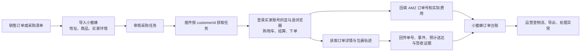

# 小蜜蜂订单、采购与物流系统逆向分析

调查日期：2026-10-22。对象：smallbee168.com、配套 2.5.5 插件、指定飞书采购订单，以及 Chrome 中已登录的 BUYER-DEMO 亚马逊账号。

**结论：小蜜蜂是“网站管理采购任务＋买家浏览器执行采购和采集物流＋网站保存并分发结果”的系统。真正连接亚马逊买家订单的部分在插件里。网站的物流查询展示最近一次同步结果，不保证与亚马逊当前页面同步。**

本轮已完成可访问客户端范围的深入拆解，并用两笔真实订单完成飞书—小蜜蜂—亚马逊核对。没有执行采购、审批、导入、插件同步、修改订单或 Walmart 发货。本报告用于下一轮方案讨论，不是已经确定的产品需求或实施方案。

公开版保留原调研结论；以下订单标识、环境名等均为占位。原始截图与逐单记录不随仓库分发。

## 1. 证据范围与可信度

|标记|含义|本轮覆盖|
|---|---|---|
|实测|浏览器页面和其真实查询响应|当前账号菜单、订单查询、公开物流查询、两笔 BUYER-DEMO 亚马逊订单及物流、飞书采购记录|
|源码|公开前端资源或用户提供的插件中可直接确认|任务协议、采购步骤、校验条件、状态码、同步载荷、部分异常分支|
|说明|网站链接的官方使用文档|导入和审批流程、积分扣除时点、建议同步频次、价格监控频次|
|推断|由上述证据推导，未执行破坏性或交易性验证|重复采购风险、多包裹遗漏风险、后续系统应补足的能力|

浏览器中当前账号实际可见的主菜单为：首页、拍单管理→Amazon 拍单、ASIN 价格监控。公开打包文件还包含其他业务模块，但不能据此认定当前账号拥有这些模块的权限。

网站管理端采用 Vue/Element 风格的单页应用，公开资源有 RuoYi-Vue 组件和链接痕迹，统一请求路径为 `/prod-api`，常规请求超时 30 秒。可以确认客户端框架和接口边界，不能仅据前端痕迹确定服务器技术栈、数据库类型或部署架构。

未取得服务器源代码、数据库、任务调度配置和后台权限策略；未验证服务端事务、去重锁、积分退款、数据保留期及所有边界情形。没有尝试绕过权限，也没有调用可能领取任务或写入业务数据的插件接口。

插件核对：原始 `smallBee 3.crx` 为 CRX3，清单为 Manifest V3、版本 2.5.5。原 CRX、现有解包目录、网站官方下载包里的主脚本完全相同，SHA-256 为 `ccea207c451a7bbff336ff222bef7597a6f02c9f01dd615aca23ab35b0a7d8b8`。因此本次分析与用户提供的插件一致；没有把安装问题误归因于 Manifest V2。

## 2. 实际业务链路

这里有三层身份需要区分：销售店铺、采购执行环境/买家账号、亚马逊内部 `customerId`。BUYER-DEMO 是采购环境，实际样本关联的销售店铺编号是 STORE-DEMO；不能用同一个“店铺”字段覆盖两者。插件按 `customerId` 领取该买家对应的任务，这也是多个隔离浏览器并行工作的基础。

官方文档描述两种入口：导入时 AMZ 订单号为空，走自动采购；已经填入 AMZ 订单号，走已有订单物流同步。网站并非必须代下单才能提供物流信息。

## 3. 订单页面的结构与操作

### 3.1 输入与展示

订单查询支持店铺、平台订单号批量列表、AMZ 订单号、买家号、备注、采购状态、物流状态、国家、创建及采购时间范围。查询接口采用分页 POST，响应包含 `total / rows / code / msg`。

导入模板包含 15 列：店铺账号、平台订单号、收货人姓名、收货人地址、收货人城市、收货人州/省、邮编、收货人电话、AMZ 订单号、买家号、买家号 ID、收货人国家、ASIN、数量、收货人区。页面限制 xls/xlsx、10 MB；日本地址有“区”校验。多商品以 ASIN 和数量的对应列表表达，不能仅按订单头处理数量。

一条订单记录同时装载以下信息：

- 业务关联：内部 ID、店铺、业务订单号、AMZ 订单号、买家号及 customerId。
- 商品：ASIN、子商品列表、数量、图片、采购价格和商品状态。
- 收货：国家、省州、市、区、详细地址、姓名、电话、邮编。
- 成本：商品小计、运费、税前金额、税额、总额、支付卡信息。
- 执行：采购状态、失败原因、备注、创建者、创建/采购/更新时间。
- 物流：承运商、物流单号、预计/实际送达日期、物流状态、地址与 ASIN 校验结果。

页面支持导入、导出、审批、异常重置、删除，以及修改备注、AMZ 订单号、商品 ASIN、收货资料和买家信息。以上写入入口仅从界面及源码分析，没有实际提交。

### 3.2 两套独立状态

|采购状态 `status`|含义|前端行为|
|---|---|---|
|0|待审核|允许审批|
|21|待拍单|等待插件处理|
|1|已拍单|不能等同于物流完成|
|99|拍单异常|允许批量重置为待拍单|

|物流状态 `orderStatus`|含义|
|---|---|
|0|未同步|
|1|已签收|
|2|运输中|
|3|未发货|
|91|已取消|
|92|不存在|

源码中取消和退款相关页面可归到 91，部分无法找到订单/物流的分支归到 92。因此这些状态不能直接作为完整的售后状态体系；尤其不能把 92 简单解释成“确认没有采购成功”。前端限制也不能证明后台具有相同的校验。

## 4. 插件如何采购

插件在亚马逊订单历史相关页面注入浮动操作面板，提供开始同步、开始拍单、提取 customerId、轨迹同步入口。清单匹配美国、加拿大、日本站；源码也有对应站点和时区配置，但本轮只验证美国站的只读查询。

采购流程源码显示：

1. 从当前亚马逊页面提取 customerId，向小蜜蜂获取待拍单任务。
2. 获取并上传当前站点匹配的 Cookie；随后判断是否有任务。
3. 批次开始先清空购物车，逐笔处理任务。
4. 加入任务商品和数量，处理地址、配送选项、优惠券和支付方式。
5. 校验 ASIN、数量、邮编、配送文本、预计送达和金额等。
6. 点击亚马逊下单按钮，等待成功页面；遇银行卡验证时等待人工处理。
7. 打开订单历史，读取第一张订单卡片，提取订单号、商品、金额等并回传。

交货天数设置范围为 1—30 天，默认 7 天；有礼品卡开关和指定信用卡末四位的配置。官方文档中关于卡片选择的部分说明落后于当前代码，应以实际版本为准。

**金额校验不是完整的利润保护。** 代码把当前结算页面各商品单价×数量的合计，与当前结算总额比较；使用礼品卡时加回抵扣额，差异超过 50% 才拒绝。这不等于“与采购审批时的目标成本比较”，也不等于“按销售利润底线控制采购”。

本轮没有实际进入或提交结算，所以不能据此宣称所有地址、优惠券、卡片或银行验证组合都可用。

## 5. 物流采集与对外查询

### 5.1 采集位置与数据

插件用已登录买家会话访问订单详情，再进入包裹追踪页面，读取承运商、单号、轨迹事件、预计送达、签收图片链接等信息。它同时读取订单商品、金额、邮编和支付卡信息，用于核验并回传。

回传包括结构化轨迹 `trackingJson` 和 Base64 编码的页面 HTML `trackingHtml`。Base64 仅是编码；不能视为加密或脱敏。事件结构为 `day / time / tracking_info / state / city`，样本事件日期没有年份，且没有明确的 UTC 偏移。

对于包裹列表，源码收集多个追踪链接后，在默认路径选择 `uniqueTrackingHrefs[0]`；任务也可携带指定追踪 URL。这说明默认采集有只覆盖第一个包裹的风险，不能据此保证一单多包裹完整。

### 5.2 查询页面

[物流查询页](https://smallbee168.com/track.html)支持最多 1000 个订单号和导出。实测需要的是小蜜蜂的业务 `orderNo`：

|名称|本系统字段|样本 A|
|---|---|---|
|页面“平台订单号”|`orderNo`|`PO-DEMO-A`|
|页面“AMZ 订单号”|`platformOrderNo`|`AMZ-DEMO-A`|
|亚马逊物流单号|`platformTrackNo`|USPS，`TRACK-DEMO-A`|

这里的业务订单号实际包含了销售订单号与商品编码组合。新系统应分别存储销售订单、销售行、采购订单、包裹，避免依赖拼接字符串关联。

两笔 AMZ 订单号直接提交查询时，接口返回成功但数据为空；换成对应业务订单号后，均查到正确记录。HTTP 成功并不代表查到了订单。

实测查询响应只有 9 个字段：业务订单号、AMZ 订单号、ASIN、承运商、物流单号、轨迹 JSON、签收图片、送达日期、物流状态，没有返回采购成本或收货地址。官方文档称无需账号密码；本轮沿用了现有浏览器，未单独测试匿名会话的权限边界。

### 5.3 两笔订单的核验结论（公开摘要）

|对照项|样本 A|样本 B|
|---|---|---|
|亚马逊订单页|已进入派送|已签收|
|小蜜蜂查询页|仍停留在上一条运输事件|签收状态一致，最新事件年份显示为 2001|
|业务含义|需分别记录事件时间与最近采集时间|缺少年份时不能交给浏览器猜测|

第二笔的日期字符串含有“20”日，前端用 `day.includes('20')` 判断是否已经含年份，因此跳过补全年份；同一卡片的结构化送达日期年份正确。两笔 USPS 样本都没有签收图片。未公开逐单明细或截图。

## 6. 已识别的问题与业务影响

|问题|依据|实际影响或需防范的情形|
|---|---|---|
|轨迹年份错误|实测＋查询页源码|查询展示可能把 2026 年事件显示为 2001 年，影响人工判断|
|物流不是实时|两笔样本中的 A|需区分事件时间、采集时间、系统更新时间；显示数据是否过期|
|默认仅取首个包裹链接|插件源码|拆包订单可能遗漏部分单号或签收状态；本轮未复现真实拆包|
|下单后以首张历史卡片回填|插件源码|同账号并行或人工下单时存在串单可能；本轮未观察到串单|
|已下单与回填失败混在异常状态|插件源码＋重置入口|真实下单成功但回填失败后，直接重置可能导致重复采购；需先查单|
|客户端锁只存在当前页面|`window.purchaseBatchInProgress`|刷新、另一个标签页或另一浏览器不能靠此锁互斥；服务端锁未知|
|金额校验缺少审批成本基准|结算源码|不能替代超预算、税运费和最低毛利控制|
|HTTP 成功与业务成功混用|通用 request 与若干回传处理|部分回传未检查 `code` 就记成功日志，可能掩盖业务写入失败|
|等待亚马逊确认可以无限持续|等待循环源码|能避免银行验证时过早判失败，但需要任务停滞识别和恢复入口|
|取消与退款状态合并|插件状态映射|不足以表达部分退款、退货、取消处理中与已退款金额|
|Cookie 会被上传|插件与后台脚本|点击开始同步/拍单会上传站点匹配 Cookie，即便任务为空；本轮未执行上传|

Cookie 机制是直接代码事实：后台调用 `chrome.cookies.getAll({url})` 并包含 Cookie 值和 HttpOnly 标记，前台随后发送到小蜜蜂 `updateBuyerCookie`。清单主机权限是 `*://*/*`。这不证明服务商恶意使用数据，但会影响自建系统的会话保管方式；订单采集所需结果和浏览器登录凭证应分别考虑。

## 7. 周边模块与不能夸大的能力

ASIN 价格监控页面提供店铺、ASIN、国家、销售价、亚马逊价、盈亏、创建和更新时间，以及导入、导出、修改销售价等入口。当前账号查询结果为空。官方文档描述每日更新；客户端接收服务端的 `profitAndLoss`，本轮没有取得或验证它的利润公式。

公开前端打包文件包含 Pig、Jc、Qt、CNYZ、JDYZ 等订单/物流适配模块、积分记录和一些管理模块。部分代码显示“待获取单号、待同步轨迹、等待推送、已推送、推送失败、是否发货”等独立状态，也有首条轨迹时间与邮编校验。它们说明系统还有物流加工和分发分支，但本轮没有访问未授权角色页面或调用这些接口，也没有确认这些名称对应的实际供应商。

官方文档写明：审批进入待拍单时扣积分；单笔同步有频次限制；建议每天多次手动启动同步；浏览器自动调度仍标记开发中。上述均为文档说明，未通过扣费、批量同步或后台调度实验验证。

没有证据证明当前主订单页或插件已完成 Walmart 履单回写。拿到亚马逊物流、保存到小蜜蜂、运营导出、提交 Walmart 发货、Walmart 最终确认，是不同完成层级。

## 8. 与现有运营系统的接点

本轮只读核查了 `沃尔玛操作台` 的项目说明、订单模型、订单接口、采购方匹配和物流查询服务。项目现有约定为 PostgreSQL 主数据、页面/API 操作、旧生产项目只读和默认禁止 Walmart 实际写入。

|现有能力|本次核查结果|与小蜜蜂能力的关系|
|---|---|---|
|Walmart 销售订单和订单行|已有 `walmart_orders / order_lines`|可作为上游来源，不应新建另一份互不关联的销售订单账|
|审核和采购状态|已有审核、采购状态、实际成本字段|可以承接采购审批与结果，但“标记已采购”不是自动采购执行器|
|采购方配置|按来源平台、配送方式、价格、地区、优先级匹配|采购方和 BUYER-DEMO 这类具体买家环境仍是不同维度|
|物流字段|订单行上已有承运商、单号|当前检查范围未发现独立采购订单/多包裹模型；不能只再加一个 AMZ 单号字段解决关联|
|履单接口|已有 acknowledge、ship、cancel、refund 等接口|可作为后续下游动作入口；本轮没有验证生产写入|
|物流查询服务|有 17track、track123 适配与缓存|可补充物流事件来源，但未实测凭证或服务可用性，不能代替买家订单关联|

特别注意：现有 `walmart_orders.purchase_order_id` 是 **Walmart 的 purchaseOrderId**，不是亚马逊采购订单号。若把 AMZ 号码写入该字段，会破坏原有 Walmart 履单关联。

后续设计讨论应围绕六个对象展开：销售订单行、采购任务、采购尝试、供应方订单、实际包裹、物流事件/证据；再独立记录下游发货提交与确认。这里是从逆向结果得到的讨论边界，本轮没有修改现有数据库或确定最终表结构。

## 9. 下一轮方案讨论需要解决的决策

1. 自采与外部采购方分别承担哪些动作，BUYER-DEMO 等环境由谁维护、谁接管异常。
2. 一条销售行允许拆成几笔采购，一笔采购允许几个包裹，如何分摊数量和成本。
3. 首期先做采购后查单/物流闭环，还是同时纳入自动下单；两者的验收风险不同。
4. 超预算、延迟、取消、缺货、地址变更、已付款但未回填各自进入什么人工队列。
5. 运营、采购、物流方各自能看到什么；向上下游输出真实单号、轨迹、签收证据的方式。
6. 哪些条件满足后才允许写入 Walmart 发货，以及如何记录平台接受和最终观察结果。

后续还需要专门的拆包、部分退款、未发货、取消、无轨迹、TBA 签收图片样本，才能验证对应流程。两笔成功查单样本不能覆盖这些分支。

## 10. 来源与附件

- [小蜜蜂订单工作台](https://smallbee168.com/order/amazonOrder)、[物流查询页](https://smallbee168.com/track.html)。
- [网站链接的官方使用说明](https://docs.qq.com/aio/DTHVBaG9LRWREdU5M)。
- 指定飞书订单中心（私人链接不公开）：仅使用 BUYER-DEMO 样本做核对，没有导出整表。
- 亚马逊已登录买家页面：上述两笔订单详情与 Track package / See all updates。
- [接口与字段附录](接口与字段附录.md)、[证据索引](证据索引.md)。

研究结果按 2026-10-22 的在线资源与本地插件版本记录；网站和亚马逊页面后续变化会影响采集规则。
